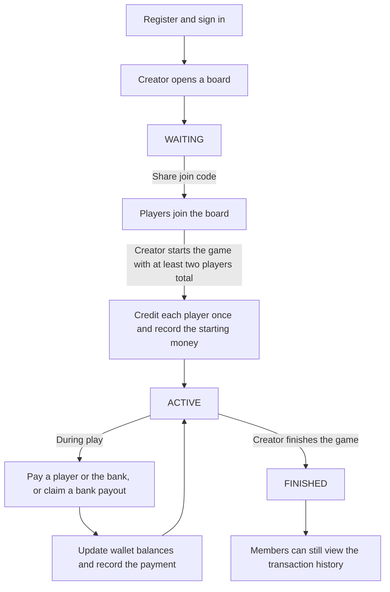

# BoardWallet

BoardWallet is a multiplayer wallet API for the Business board game. Each board has its own player wallets, an unlimited bank, and a transaction history. All balances represent game money.

## How a game works



- A player creates a board with a starting amount and shares its join code. Other players join while the board is in `WAITING`.
- The creator starts the game once the board has at least two players, including the creator. Starting the board moves it to `ACTIVE` and credits each player once, with a starting-money entry in the ledger.
- On an active board, members can pay another player on the same board, pay the bank, or claim a bank payout to their own wallet. A player must have sufficient funds to make a payment.
- Members can check their own balance, view bank totals, and browse the board's transaction history. The creator can finish the game, moving it to `FINISHED` and closing it to new payments.

## Run locally

Use Java 21, MySQL, and the included Maven Wrapper. The app uses Spring Boot 4.1.2, Spring MVC and Validation, Spring Data JPA with Hibernate, and Spring Security's OAuth2 Resource Server.

1. Create a local MySQL database named `boardwallet` and give your local database user access to it. The default connection is `localhost:3306`. Hibernate updates the schema on startup.
2. Create a `.env` file in the project root using the format below. Replace the example values with your local credentials and a Base64-encoded secret of at least 32 bytes. You can generate the secret with `openssl rand -base64 32`. Git ignores `.env`.

   ```dotenv
   DB_USERNAME=your_local_mysql_user
   DB_PASSWORD=your_local_mysql_password
   JWT_SECRET=your_base64_encoded_secret
   ```

3. Start the API from the project root.

   ```sh
   ./mvnw spring-boot:run
   ```

The API listens at `http://localhost:8080` by default. Register and log in with a JSON body containing `username` and `password`. Send the returned `accessToken` as `Authorization: Bearer <accessToken>` on board requests.

## API

| Method and path | Purpose |
| --- | --- |
| `POST /api/auth/register` | Create a user |
| `POST /api/auth/login` | Get an access token and a refresh cookie |
| `POST /api/auth/refresh` | Rotate the refresh token and get a new access token |
| `POST /api/auth/logout` | Revoke the refresh-token session and clear the cookie |
| `GET /api/auth/me` | Get the authenticated username |
| `POST /api/boards` | Create a board with `name` and `startingAmount` |
| `POST /api/boards/join` | Join a waiting board with `joinCode` |
| `GET /api/boards` | List the current user's boards |
| `GET /api/boards/{boardId}` | Get board details and players |
| `POST /api/boards/{boardId}/start` | Start the game and distribute starting money |
| `POST /api/boards/{boardId}/finish` | Finish the game |
| `GET /api/boards/{boardId}/wallets/me` | Get the current player's wallet |
| `GET /api/boards/{boardId}/bank` | Get the bank wallet and transaction totals |
| `POST /api/boards/{boardId}/payments` | Pay another player on the board |
| `POST /api/boards/{boardId}/payments/bank` | Pay the board's bank |
| `POST /api/boards/{boardId}/payments/bank/payout` | Claim a payout to the caller's wallet |
| `GET /api/boards/{boardId}/transactions` | List transactions with optional `walletId`, zero-based `page`, and `size` |
| `GET /api/boards/{boardId}/transactions/{transactionId}` | Get a transaction on the board |

Refresh and logout use the `refresh_token` cookie and require the `X-BoardWallet-Refresh: 1` header. The cookie is `HttpOnly`, `Secure`, and `SameSite=Strict`. Access tokens expire after 15 minutes by default and remain valid until expiry after logout.

Every payment POST requires a UUID in the `Idempotency-Key` header. Generate a new key for each intended payment. Reuse the same key and payload when retrying. Reusing the key with a different payload returns `409 Conflict`.

## How payments stay consistent

- Spring services validate board membership and wallet ownership before applying a payment. New payments require an active board.
- A database transaction commits the balance changes and ledger entry together. Pessimistic wallet locks serialize competing balance changes, and consistent lock ordering reduces the risk of deadlocks.
- MySQL enforces uniqueness on the initiating user and idempotency key. A stored SHA-256 request fingerprint lets the service return the original result for a matching retry and reject a changed request.

## Local benchmark results

Runs from November 16, 2026 tested app revision `0f6bd07`. The app, MySQL, and k6 shared one Apple Silicon Mac with 8 logical CPUs and 16 GiB of RAM. The synthetic database held **1 million users**, **100,000 active boards**, **2.2 million player wallets**, and **2.2 million starting-money transactions**. k6 rotated through a pool of up to 10,000 test identities.

### Read throughput

k6 measured HTTP latency across board, wallet, and transaction reads. The table shows passing runs, each with zero dropped iterations.

| Target req/s | Duration | Measured req/s | p95 | p99 | Dropped iterations | Result |
| ---: | ---: | ---: | ---: | ---: | ---: | --- |
| 100 | 60 s | 100.0 | 25.4 ms | 61.6 ms | 0 | Pass |
| 250 | 60 s | 250.0 | 15.1 ms | 55.4 ms | 0 | Pass |
| 500 | 60 s | 500.0 | 7.0 ms | 11.8 ms | 0 | Pass on rerun |

### Payment and access-control checks

| Scenario | Load | Observed result |
| --- | --- | --- |
| Two-wallet contention | 500 payments across 50 virtual users | All 500 committed with zero balance mismatches and zero observed deadlocks. Payment p95 was 255.0 ms. |
| Duplicate payment | 500 requests with the same key and payload across 50 virtual users | All 500 returned success and produced one committed transfer. |
| Idempotency conflict | 20 requests reused a committed payment's key with a different amount | All 20 returned `409 Conflict`. The original transfer was the only commit. |
| Concurrent overspend | 20 requests each tried to spend half the initial balance | Two payments committed, 18 were rejected, and balances reconciled with the ledger. |
| Access and validation | 6 requests expected to be rejected | All six returned the expected status and produced zero transfers. |

These figures describe the recorded local runs. The contention scenario recorded 499 MySQL row-lock waits and 12.9 seconds of cumulative wait time in server-wide counters.

## Checks and reproduction

- Run `./mvnw test` with the local MySQL configuration to exercise the Spring context test.
- With the app running, execute `bash scripts/test-board-start.sh` for end-to-end API checks. It requires `curl`, `jq`, `rg`, and `uuidgen`, and leaves test users, boards, and payments in MySQL.
- See the [dataset guide](scripts/seed/SEEDING.md) for generating a synthetic workload fixture and the [benchmark guide](scripts/benchmark/README.md) for k6 scenarios, validation, and how to read the reports.
